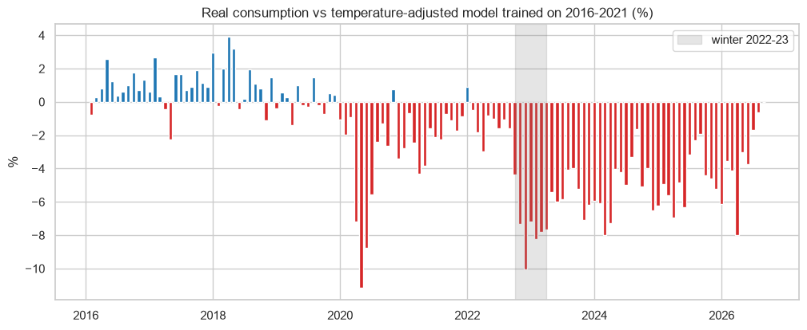
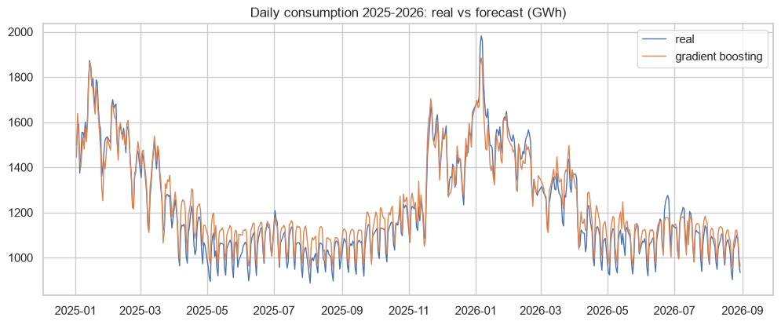

# Electricity demand in France: temperature, sobriety and forecasting

How much the temperature explains the French electricity consumption, how much demand fell in the 2022-2023 energy crisis after removing the weather, and a daily forecasting model.

## Data
RTE eco2mix consolidated consumption (2012-2026) and daily regional temperatures (ODRE).

## Main results
- With temperature and calendar the linear model explains 97% of the daily consumption; every degree below 15 C adds around 1.800 MW.
- Winter 2022-23: consumption 8% below what the temperature explained. In winter 2025-26 still -5%.
- Forecast of 2025-2026: MAPE close to 4% for the linear model and the gradient boosting, against 7% for the naive forecast.




## How to run

```
pip install -r requirements.txt
jupyter notebook france_electricity_demand.ipynb
```

---
Alejandro Lezcano Osorio | Universidad EIA (Colombia) and Rennes School of Business (France)
